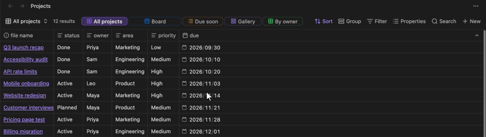
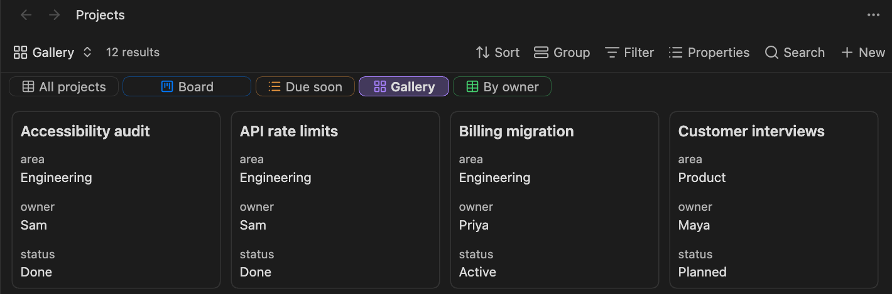

# View Tabs for Bases

**English** | [日本語](docs/README.ja.md) | [简体中文](docs/README.zh.md) | [繁體中文](docs/README.zh-TW.md) | [한국어](docs/README.ko.md) | [Deutsch](docs/README.de.md) | [Français](docs/README.fr.md) | [Español](docs/README.es.md)

See every view of an Obsidian [base](https://help.obsidian.md/bases) at a glance. This plugin lists a base's views as tabs right next to the result count, so you can switch views with one click instead of opening the view menu.



## Features

- **Tabs in the toolbar**: each view gets a tab beside the result count, with its view type's icon. The current view is highlighted.
- **One-click switching**: click a tab to open its view.
- **Drag to reorder**: drop a tab onto another to move it. This reorders the views themselves, so the built-in view menu shows the same order.
- **Per-view tab settings**: choose whether each view has a tab, and set the tab's color (icon and outline; the selected tab is filled with it) and size (width).
- **Context menu**: right-click a tab to change its color or size, or to remove it from the tabs.
- **Scrolls when crowded**: when the tabs don't fit, they scroll sideways (the mouse wheel works too) and fade at the edges. The built-in toolbar buttons keep their size.
- **Tabs below the toolbar**: optionally put the tabs on a row of their own under the toolbar, where they can wrap onto more lines.
- **Keyboard switching**: commands to switch to the next or previous tab, which you can bind to any hotkeys.

## Installation

- **Community plugins**: open **Settings → Community plugins → Browse**, search for "View Tabs for Bases", select **Install**, then **Enable**.
- **Manual**: download `main.js`, `manifest.json` and `styles.css` from the [latest release](https://github.com/TTTatsuO/obsidian-view-tabs-for-bases/releases/latest) into `<Vault>/.obsidian/plugins/view-tabs-for-bases/`, then enable the plugin in **Settings → Community plugins**.

Requires Obsidian 1.14.0 or later. Desktop only.

## Usage

Open a `.base` file. Its views appear as tabs next to the result count.


To change a tab, right-click it and pick a color, a size, or **Remove from tabs**.


You can also open **Configure view** from the view menu and use the **Tab settings** section at the bottom: **Show in tabs**, **Color** and **Size**.


To bring back a removed tab, open that view's **Configure view** from the view menu and turn **Show in tabs** back on.

To switch views from the keyboard, assign hotkeys to **Switch to next view** and **Switch to previous view** in **Settings → Hotkeys**. They move through the tabs in order, wrap around at the ends, and skip views removed from the tabs. No hotkeys are set by default.

### Plugin settings

- **View tab position**: **Next to the result count** (the default), **Below the toolbar**, or **Don't show** to turn the tabs off everywhere.
- **Show view type icons**: show each view's type icon (table, cards and so on) on its tab. On by default.
- **Wrap view tabs**: below the toolbar, wrap tabs that don't fit onto more lines instead of scrolling sideways. Available only when **View tab position** is **Below the toolbar**.
- **Keep the selected cell when switching views**: see below.



### Keeping the selected cell

Obsidian remembers the selected cell and scroll position of each view while you switch views. But when you switch between two views of the same type (for example, two tables) and come back, it sometimes loses them. Obsidian reuses the table for the new view and restores the position before the new rows have loaded, so a cell beyond the previous view's rows is dropped.

**Keep the selected cell when switching views** (on by default) works around this: once the new rows have loaded, it puts the selected cell and scroll position back. It relies on Obsidian's internals, so if switching views ever behaves oddly, turn it off in the plugin's settings. Obsidian then works as it does without the plugin.

### Where settings are stored

Tab settings are saved in the `.base` file, inside each view, under a single key. Only values that differ from the defaults are written:

```yaml
views:
  - type: table
    name: Overview
    viewTabsForBases:
      color: blue
      size: large
  - type: table
    name: Drafts
    viewTabsForBases:
      show: false
```

The settings stay with the base when you rename, copy or sync it. If you uninstall the plugin, Obsidian ignores the key, and you can delete it by hand.

## Languages

The plugin follows Obsidian's language. It's available in English, العربية, বাংলা, Català, Čeština, Dansk, Deutsch, Ελληνικά, Español, فارسی, Suomi, Français, עברית, Magyar, Bahasa Indonesia, Italiano, 日本語, ខ្មែរ, 한국어, Nederlands, Norsk, Polski, Português, Português do Brasil, Română, Русский, Slovenčina, Svenska, ไทย, Türkçe, Українська, Tiếng Việt, 简体中文 and 繁體中文. Other languages fall back to English.

Apart from English and Japanese, the translations haven't been reviewed by native speakers yet. If something reads oddly in your language, please open an issue or a pull request that edits [`src/i18n.ts`](src/i18n.ts).

## Limitations

- Tabs appear only for a `.base` file open in its own tab. Bases embedded in notes (`![[file.base]]` or `base` code blocks) aren't supported yet.
- In pop-out windows the tabs work, but the **Tab settings** section doesn't appear in **Configure view**. Use the tab's context menu there instead.
- Desktop only.
- Obsidian has no public API for the Bases toolbar or its list of views, so the plugin relies on Obsidian's internals for these. A future Obsidian update may stop the tabs from showing. If that happens, the plugin quietly does nothing: your bases and views are left untouched, and the tab settings stay in the file.

## License

[MIT](LICENSE)
