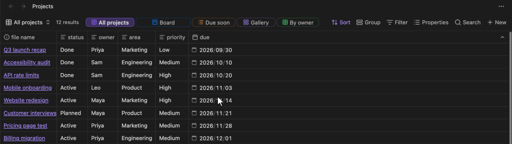
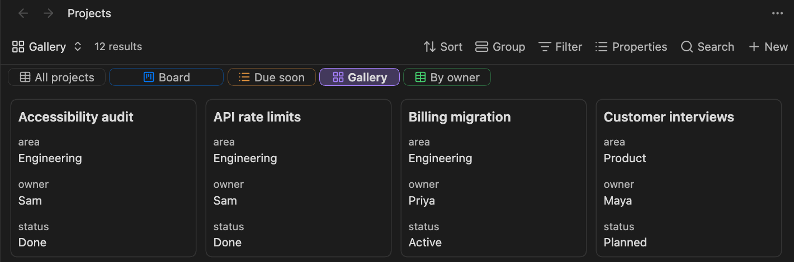

# View Tabs for Bases

[English](../README.md) | [日本語](README.ja.md) | [简体中文](README.zh.md) | [繁體中文](README.zh-TW.md) | [한국어](README.ko.md) | **Deutsch** | [Français](README.fr.md) | [Español](README.es.md)

Alle Ansichten einer Obsidian-[Base](https://help.obsidian.md/bases) auf einen Blick. Dieses Plugin zeigt die Ansichten einer Base als Tabs direkt neben der Ergebnisanzahl, sodass du mit einem Klick zwischen Ansichten wechseln kannst, ohne das Ansichtsmenü zu öffnen.



## Funktionen

- **Tabs in der Werkzeugleiste**: Jede Ansicht erhält neben der Ergebnisanzahl einen Tab, mit dem Symbol des Ansichtstyps; die aktuelle Ansicht ist hervorgehoben.
- **Wechsel mit einem Klick**: Ein Klick auf einen Tab öffnet seine Ansicht.
- **Per Drag-and-drop sortieren**: Ziehe einen Tab auf einen anderen, um ihn zu verschieben. Dabei ändert sich die Reihenfolge der Ansichten selbst, sodass das eingebaute Ansichtsmenü dieselbe Reihenfolge zeigt.
- **Tab-Einstellungen pro Ansicht**: Lege für jede Ansicht fest, ob sie einen Tab hat, und wähle Farbe (Symbol und Rahmen; der ausgewählte Tab wird damit gefüllt) und Größe (Breite) des Tabs.
- **Kontextmenü**: Klicke mit der rechten Maustaste auf einen Tab, um Farbe oder Größe zu ändern oder ihn aus den Tabs zu entfernen.
- **Scrollt bei Platzmangel**: Passen die Tabs nicht hinein, lassen sie sich seitlich scrollen (auch mit dem Mausrad) und blenden an den Rändern aus. Die eingebauten Schaltflächen der Werkzeugleiste behalten ihre Größe.
- **Tabs unter der Werkzeugleiste**: Die Tabs können auch in einer eigenen Zeile unter der Werkzeugleiste stehen und dort auf mehrere Zeilen umbrechen.
- **Wechseln per Tastatur**: Befehle zum Wechseln zum nächsten oder vorherigen Tab, die du beliebigen Tastenkürzeln zuweisen kannst.

## Installation

- **Community-Plugins**: Öffne **Settings → Community plugins → Browse**, suche nach „View Tabs for Bases“, wähle **Install** und dann **Enable**.
- **Manuell**: Lade `main.js`, `manifest.json` und `styles.css` aus dem [neuesten Release](https://github.com/TTTatsuO/obsidian-view-tabs-for-bases/releases/latest) nach `<Vault>/.obsidian/plugins/view-tabs-for-bases/` herunter und aktiviere das Plugin unter **Settings → Community plugins**.

Erfordert Obsidian 1.14.0 oder neuer. Nur für Desktop.

## Verwendung

Öffne eine `.base`-Datei. Ihre Ansichten erscheinen als Tabs neben der Ergebnisanzahl.


Um einen Tab zu ändern, klicke ihn mit der rechten Maustaste an und wähle eine Farbe, eine Größe oder **Aus Tabs entfernen**.


Du kannst auch über das Ansichtsmenü **Configure view** (die Ansichtseinstellungen) öffnen und den Abschnitt **Tab-Einstellungen** ganz unten verwenden: **In Tabs anzeigen**, **Farbe** und **Größe**.


Um einen entfernten Tab zurückzuholen, öffne über das Ansichtsmenü **Configure view** dieser Ansicht und schalte **In Tabs anzeigen** wieder ein.

Um Ansichten per Tastatur zu wechseln, weise unter **Settings → Hotkeys** den Befehlen **Zur nächsten Ansicht wechseln** und **Zur vorherigen Ansicht wechseln** Tastenkürzel zu. Sie gehen die Tabs der Reihe nach durch, springen am Ende wieder an den Anfang und überspringen aus den Tabs entfernte Ansichten. Standardmäßig sind keine Tastenkürzel gesetzt.

### Plugin-Einstellungen

- **Position der Ansichts-Tabs**: **Neben der Ergebnisanzahl** (Standard), **Unter der Werkzeugleiste** oder **Nicht anzeigen**, um die Tabs überall auszuschalten.
- **Ansichts-Tabs umbrechen**: Unter der Werkzeugleiste werden Tabs, die nicht passen, auf weitere Zeilen umbrochen, statt seitlich zu scrollen. Nur verfügbar, wenn **Position der Ansichts-Tabs** auf **Unter der Werkzeugleiste** steht.
- **Symbole für Ansichtstyp anzeigen**: zeigt auf jedem Tab das Symbol des Ansichtstyps (Tabelle, Karten usw.). Standardmäßig an.
- **Ausgewählte Zelle beim Ansichtswechsel behalten**: siehe unten.



### Ausgewählte Zelle behalten

Obsidian merkt sich beim Ansichtswechsel für jede Ansicht die ausgewählte Zelle und die Scrollposition. Wechselst du aber zwischen zwei Ansichten desselben Typs (zum Beispiel zwei Tabellen) und kehrst zurück, gehen sie manchmal verloren. Obsidian verwendet die Tabelle für die neue Ansicht weiter und stellt die Position wieder her, bevor die neuen Zeilen geladen sind. Eine Zelle jenseits der Zeilen der vorherigen Ansicht wird dabei verworfen.

**Ausgewählte Zelle beim Ansichtswechsel behalten** (standardmäßig an) umgeht das: Sobald die neuen Zeilen geladen sind, werden ausgewählte Zelle und Scrollposition erneut wiederhergestellt. Die Option nutzt interne Teile von Obsidian. Verhält sich der Ansichtswechsel seltsam, schalte sie in den Plugin-Einstellungen aus. Obsidian verhält sich dann wie ohne das Plugin.

### Wo die Einstellungen gespeichert werden

Die Tab-Einstellungen werden in der `.base`-Datei innerhalb jeder Ansicht unter einem einzigen Schlüssel gespeichert. Es werden nur Werte geschrieben, die vom Standard abweichen:

```yaml
views:
  - type: table
    name: Overview
    viewTabsForBases:
      color: blue
      size: large
  - type: table
    name: Drafts
    viewTabsForBases:
      show: false
```

Die Einstellungen bleiben daher erhalten, wenn du die Base umbenennst, kopierst oder synchronisierst. Wenn du das Plugin deinstallierst, ignoriert Obsidian den Schlüssel; du kannst ihn auch von Hand löschen.

## Sprachen

Das Plugin folgt der Sprache von Obsidian. Es ist verfügbar auf English, العربية, বাংলা, Català, Čeština, Dansk, Deutsch, Ελληνικά, Español, فارسی, Suomi, Français, עברית, Magyar, Bahasa Indonesia, Italiano, 日本語, ខ្មែរ, 한국어, Nederlands, Norsk, Polski, Português, Português do Brasil, Română, Русский, Slovenčina, Svenska, ไทย, Türkçe, Українська, Tiếng Việt, 简体中文 und 繁體中文. Andere Sprachen fallen auf Englisch zurück.

Außer Englisch und Japanisch wurden die Übersetzungen noch nicht von Muttersprachlern geprüft. Wenn etwas in deiner Sprache seltsam klingt, eröffne bitte ein Issue oder einen Pull Request, der [`src/i18n.ts`](../src/i18n.ts) bearbeitet.

## Einschränkungen

- Tabs erscheinen nur, wenn eine `.base`-Datei in einem eigenen Tab geöffnet ist. In Notizen eingebettete Bases (`![[file.base]]` oder `base`-Codeblöcke) werden noch nicht unterstützt.
- In ausgelagerten Fenstern funktionieren die Tabs, aber der Abschnitt **Tab-Einstellungen** erscheint nicht in **Configure view**. Verwende dort stattdessen das Kontextmenü des Tabs.
- Nur für Desktop.
- Obsidian bietet keine öffentliche API für die Werkzeugleiste von Bases oder deren Ansichtsliste, daher nutzt das Plugin hierfür interne Mechanismen von Obsidian. Ein zukünftiges Obsidian-Update könnte dazu führen, dass die Tabs nicht mehr erscheinen. In diesem Fall tut das Plugin einfach nichts: Deine Bases und Ansichten bleiben unverändert, und die Tab-Einstellungen bleiben in der Datei erhalten.

## Lizenz

[MIT](../LICENSE)
