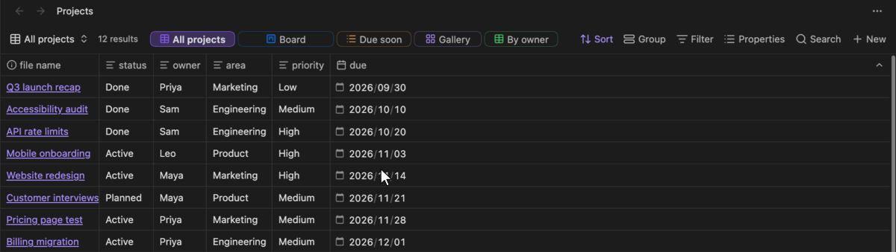
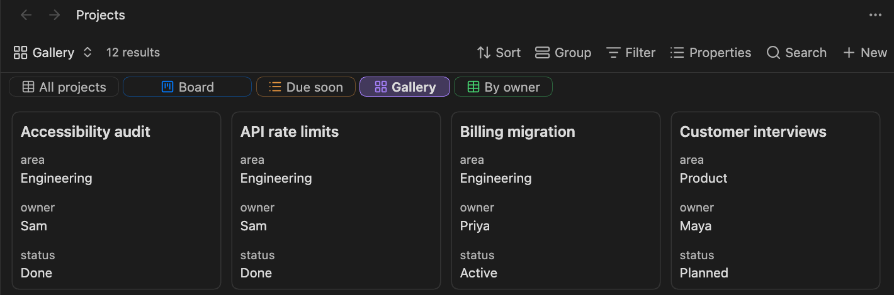

# View Tabs for Bases

[English](../README.md) | [日本語](README.ja.md) | [简体中文](README.zh.md) | [繁體中文](README.zh-TW.md) | [한국어](README.ko.md) | [Deutsch](README.de.md) | [Français](README.fr.md) | **Español**

Ve de un vistazo todas las vistas de una [base](https://help.obsidian.md/bases) de Obsidian. Este plugin muestra las vistas de una base como pestañas justo al lado del número de resultados, para que cambies de vista con un clic sin abrir el menú de vistas.



## Funciones

- **Pestañas en la barra de herramientas**: cada vista tiene una pestaña junto al número de resultados, con el icono de su tipo de vista, y la vista actual aparece resaltada.
- **Cambio con un clic**: haz clic en una pestaña para abrir su vista.
- **Reordenar arrastrando**: suelta una pestaña sobre otra para moverla. Esto cambia el orden de las propias vistas, así que el menú de vistas integrado muestra el mismo orden.
- **Ajustes de pestaña por vista**: elige si cada vista tiene pestaña y define el color (icono y contorno; la pestaña seleccionada se rellena con él) y el tamaño (ancho) de la pestaña.
- **Menú contextual**: haz clic derecho en una pestaña para cambiar su color o tamaño, o para quitarla de las pestañas.
- **Se desplaza cuando no cabe**: si las pestañas no caben, se desplazan en horizontal (también con la rueda del ratón) y se desvanecen en los bordes. Los botones integrados de la barra de herramientas mantienen su tamaño.
- **Pestañas bajo la barra de herramientas**: si quieres, las pestañas pueden ir en una fila propia bajo la barra de herramientas, donde pueden pasar a varias líneas.
- **Cambio con el teclado**: comandos para cambiar a la pestaña siguiente o anterior, que puedes asignar a cualquier atajo.

## Instalación

- **Plugins de la comunidad**: abre **Settings → Community plugins → Browse**, busca «View Tabs for Bases», elige **Install** y luego **Enable**.
- **Manual**: descarga `main.js`, `manifest.json` y `styles.css` de la [última versión](https://github.com/TTTatsuO/obsidian-view-tabs-for-bases/releases/latest) en `<Vault>/.obsidian/plugins/view-tabs-for-bases/` y activa el plugin en **Settings → Community plugins**.

Requiere Obsidian 1.14.0 o posterior. Solo para escritorio.

## Uso

Abre un archivo `.base`. Sus vistas aparecen como pestañas junto al número de resultados.


Para cambiar una pestaña, haz clic derecho en ella y elige un color, un tamaño o **Quitar de las pestañas**.


También puedes abrir **Configure view** (los ajustes de la vista) desde el menú de vistas y usar la sección **Ajustes de pestaña** al final: **Mostrar en pestañas**, **Color** y **Tamaño**.


Para recuperar una pestaña quitada, abre **Configure view** de esa vista desde el menú de vistas y vuelve a activar **Mostrar en pestañas**.

Para cambiar de vista con el teclado, asigna atajos a **Cambiar a la vista siguiente** y **Cambiar a la vista anterior** en **Settings → Hotkeys**. Recorren las pestañas en orden, vuelven al otro extremo al llegar al final y omiten las vistas quitadas de las pestañas. No hay atajos asignados por defecto.

### Ajustes del plugin

- **Mostrar pestañas de vistas**: desactiva las pestañas en todas partes.
- **Mostrar iconos del tipo de vista**: muestra en cada pestaña el icono del tipo de vista (tabla, tarjetas, etc.). Activado por defecto.
- **Posición de las pestañas**: **Junto al número de resultados** (por defecto) o **Bajo la barra de herramientas**.
- **Ajustar pestañas**: bajo la barra de herramientas, las pestañas que no caben pasan a más líneas en lugar de desplazarse en horizontal. Solo disponible cuando **Posición de las pestañas** es **Bajo la barra de herramientas**.
- **Mantener la celda seleccionada al cambiar de vista**: ver abajo.



### Mantener la celda seleccionada

Obsidian recuerda la celda seleccionada y la posición de desplazamiento de cada vista al cambiar de vista. Pero cuando cambias entre dos vistas del mismo tipo (por ejemplo, dos tablas) y vuelves, a veces las pierde. Obsidian reutiliza la tabla para la nueva vista y restaura la posición antes de que se carguen las filas nuevas, así que se descarta una celda que quede más allá de las filas de la vista anterior.

**Mantener la celda seleccionada al cambiar de vista** (activado por defecto) lo soluciona: cuando las filas nuevas se han cargado, vuelve a restaurar la celda seleccionada y la posición de desplazamiento. Depende de partes internas de Obsidian, así que si el cambio de vista se comporta de forma extraña, desactívalo en los ajustes del plugin. Obsidian funcionará entonces como sin el plugin.

### Dónde se guardan los ajustes

Los ajustes de pestaña se guardan en el archivo `.base`, dentro de cada vista, bajo una sola clave. Solo se escriben los valores distintos de los predeterminados:

```yaml
views:
  - type: table
    name: Overview
    viewTabsForBases:
      color: blue
      size: large
  - type: table
    name: Drafts
    viewTabsForBases:
      show: false
```

Así, los ajustes acompañan a la base cuando la renombras, la copias o la sincronizas. Si desinstalas el plugin, Obsidian ignora la clave, y puedes borrarla a mano.

## Idiomas

El plugin sigue el idioma de Obsidian. Está disponible en English, العربية, বাংলা, Català, Čeština, Dansk, Deutsch, Ελληνικά, Español, فارسی, Suomi, Français, עברית, Magyar, Bahasa Indonesia, Italiano, 日本語, ខ្មែរ, 한국어, Nederlands, Norsk, Polski, Português, Português do Brasil, Română, Русский, Slovenčina, Svenska, ไทย, Türkçe, Українська, Tiếng Việt, 简体中文 y 繁體中文. Los demás idiomas usan el inglés.

Salvo el inglés y el japonés, las traducciones aún no han sido revisadas por hablantes nativos. Si algo suena raro en tu idioma, abre una issue o una pull request que edite [`src/i18n.ts`](../src/i18n.ts).

## Limitaciones

- Las pestañas solo aparecen cuando un archivo `.base` está abierto en su propia pestaña. Las bases incrustadas en notas (`![[file.base]]` o bloques de código `base`) aún no son compatibles.
- En las ventanas emergentes las pestañas funcionan, pero la sección **Ajustes de pestaña** no aparece en **Configure view**. Usa en su lugar el menú contextual de la pestaña.
- Solo para escritorio.
- Obsidian no ofrece una API pública para la barra de herramientas de las bases ni para su lista de vistas, así que el plugin usa mecanismos internos de Obsidian para ello. Una futura actualización de Obsidian podría hacer que las pestañas dejen de aparecer. Si eso ocurre, el plugin simplemente no hace nada: tus bases y vistas no se modifican y los ajustes de pestaña se quedan en el archivo.

## Licencia

[MIT](../LICENSE)
