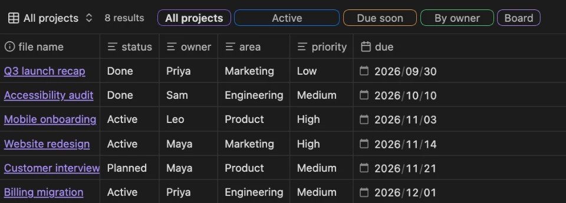
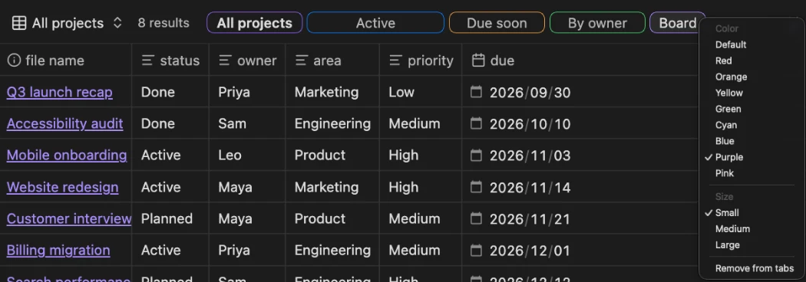
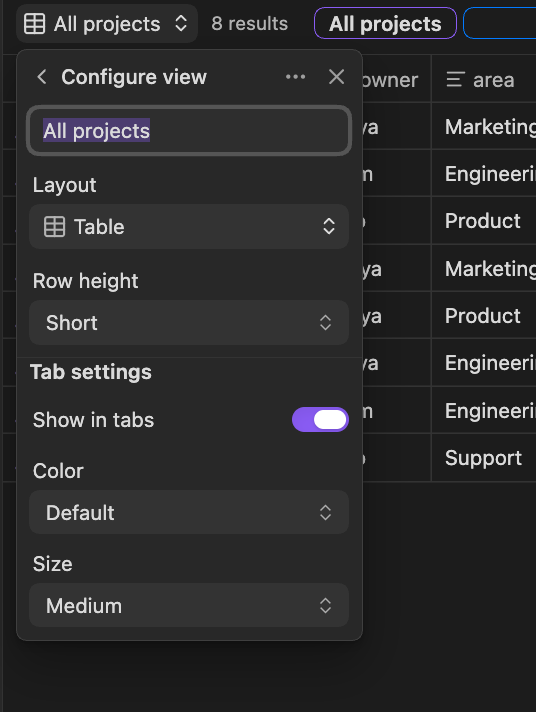

# View Tabs for Bases

[English](../README.md) | [日本語](README.ja.md) | [简体中文](README.zh.md) | [繁體中文](README.zh-TW.md) | [한국어](README.ko.md) | [Deutsch](README.de.md) | [Français](README.fr.md) | **Español**

Ve de un vistazo todas las vistas de una [base](https://help.obsidian.md/bases) de Obsidian. Este plugin muestra las vistas de una base como pestañas justo al lado del número de resultados, para que cambies de vista con un clic sin abrir el menú de vistas.



## Funciones

- **Pestañas en la barra de herramientas**: cada vista tiene una pestaña junto al número de resultados, y la vista actual aparece resaltada.
- **Cambio con un clic**: haz clic en una pestaña para abrir su vista.
- **Reordenar arrastrando**: suelta una pestaña sobre otra para moverla. Esto cambia el orden de las propias vistas, así que el menú de vistas integrado muestra el mismo orden.
- **Ajustes de pestaña por vista**: elige si cada vista tiene pestaña y define el color (contorno) y el tamaño (ancho) de la pestaña.
- **Menú contextual**: haz clic derecho en una pestaña para cambiar su color o tamaño, o para quitarla de las pestañas.
- **Se desplaza cuando no cabe**: si las pestañas no caben, se desplazan en horizontal (también con la rueda del ratón) y se desvanecen en los bordes. Los botones integrados de la barra de herramientas mantienen su tamaño.

## Instalación

- **Plugins de la comunidad** (una vez publicado): abre **Settings → Community plugins → Browse**, busca «View Tabs for Bases», elige **Install** y luego **Enable**.
- **Manual**: descarga `main.js`, `manifest.json` y `styles.css` de la [última versión](https://github.com/TTTatsuO/obsidian-view-tabs-for-bases/releases/latest) en `<Vault>/.obsidian/plugins/view-tabs-for-bases/` y activa el plugin en **Settings → Community plugins**.

Requiere Obsidian 1.14.0 o posterior. Solo para escritorio.

## Uso

Abre un archivo `.base`. Sus vistas aparecen como pestañas junto al número de resultados.

Para cambiar una pestaña, haz clic derecho en ella y elige un color, un tamaño o **Quitar de las pestañas**.



También puedes abrir **Configure view** (los ajustes de la vista) desde el menú de vistas y usar la sección **Ajustes de pestaña** al final: **Mostrar en pestañas**, **Color** y **Tamaño**.



Para recuperar una pestaña quitada, abre **Configure view** de esa vista desde el menú de vistas y vuelve a activar **Mostrar en pestañas**.

Para desactivar las pestañas en todas partes, desactiva **Mostrar pestañas de vistas** en los ajustes del plugin.

### Dónde se guardan los ajustes

Los ajustes de pestaña se guardan en el archivo `.base`, dentro de cada vista, bajo una sola clave. Solo se escriben los valores distintos de los predeterminados:

```yaml
views:
  - type: table
    name: Overview
    viewTabsForBases:
      color: blue
      size: large
  - type: table
    name: Drafts
    viewTabsForBases:
      show: false
```

Así, los ajustes acompañan a la base cuando la renombras, la copias o la sincronizas. Si desinstalas el plugin, Obsidian ignora la clave, y puedes borrarla a mano.

## Idiomas

El plugin sigue el idioma de Obsidian. Está disponible en English, العربية, বাংলা, Català, Čeština, Dansk, Deutsch, Ελληνικά, Español, فارسی, Suomi, Français, עברית, Magyar, Bahasa Indonesia, Italiano, 日本語, ខ្មែរ, 한국어, Nederlands, Norsk, Polski, Português, Português do Brasil, Română, Русский, Slovenčina, Svenska, ไทย, Türkçe, Українська, Tiếng Việt, 简体中文 y 繁體中文. Los demás idiomas usan el inglés.

Salvo el inglés y el japonés, las traducciones aún no han sido revisadas por hablantes nativos. Si algo suena raro en tu idioma, abre una issue o una pull request que edite [`src/i18n.ts`](../src/i18n.ts).

## Limitaciones

- Las pestañas solo aparecen cuando un archivo `.base` está abierto en su propia pestaña. Las bases incrustadas en notas (`![[file.base]]` o bloques de código `base`) aún no son compatibles.
- En las ventanas emergentes las pestañas funcionan, pero la sección **Ajustes de pestaña** no aparece en **Configure view**. Usa en su lugar el menú contextual de la pestaña.
- Solo para escritorio.
- Obsidian no ofrece una API pública para la barra de herramientas de las bases ni para su lista de vistas, así que el plugin usa mecanismos internos de Obsidian para ello. Una futura actualización de Obsidian podría hacer que las pestañas dejen de aparecer. Si eso ocurre, el plugin simplemente no hace nada: tus bases y vistas no se modifican y los ajustes de pestaña se quedan en el archivo.

## Licencia

[MIT](../LICENSE)
