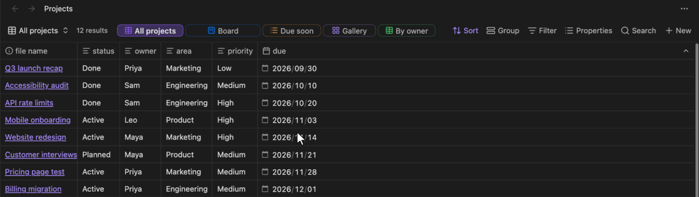
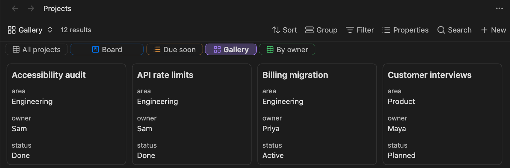

# View Tabs for Bases

[English](../README.md) | [日本語](README.ja.md) | [简体中文](README.zh.md) | [繁體中文](README.zh-TW.md) | [한국어](README.ko.md) | [Deutsch](README.de.md) | **Français** | [Español](README.es.md)

Voyez d’un coup d’œil toutes les vues d’une [base](https://help.obsidian.md/bases) Obsidian. Ce plugin affiche les vues d’une base sous forme d’onglets, juste à côté du nombre de résultats : vous changez de vue en un clic, sans ouvrir le menu des vues.



## Fonctionnalités

- **Des onglets dans la barre d’outils** : chaque vue a un onglet à côté du nombre de résultats, avec l’icône de son type de vue, et la vue courante est mise en évidence.
- **Changement en un clic** : cliquez sur un onglet pour ouvrir sa vue.
- **Réorganisation par glisser-déposer** : déposez un onglet sur un autre pour le déplacer. L’ordre des vues elles-mêmes change, donc le menu des vues intégré affiche le même ordre.
- **Réglages d’onglet par vue** : choisissez si chaque vue a un onglet, et définissez la couleur (icône et contour ; l’onglet sélectionné en est rempli) et la taille (largeur) de l’onglet.
- **Menu contextuel** : faites un clic droit sur un onglet pour changer sa couleur ou sa taille, ou pour le retirer des onglets.
- **Défilement quand la place manque** : quand les onglets ne tiennent pas, ils défilent horizontalement (la molette de la souris fonctionne aussi) et s’estompent sur les bords. Les boutons intégrés de la barre d’outils gardent leur taille.
- **Onglets sous la barre d’outils** : les onglets peuvent aussi occuper leur propre ligne sous la barre d’outils, où ils peuvent passer sur plusieurs lignes.
- **Changement au clavier** : des commandes pour passer à l’onglet suivant ou précédent, à associer aux raccourcis de votre choix.

## Installation

- **Plugins communautaires** : ouvrez **Settings → Community plugins → Browse**, recherchez « View Tabs for Bases », choisissez **Install**, puis **Enable**.
- **Manuelle** : téléchargez `main.js`, `manifest.json` et `styles.css` depuis la [dernière version](https://github.com/TTTatsuO/obsidian-view-tabs-for-bases/releases/latest) dans `<Vault>/.obsidian/plugins/view-tabs-for-bases/`, puis activez le plugin dans **Settings → Community plugins**.

Nécessite Obsidian 1.14.0 ou ultérieur. Ordinateur uniquement.

## Utilisation

Ouvrez un fichier `.base`. Ses vues apparaissent sous forme d’onglets à côté du nombre de résultats.


Pour modifier un onglet, faites un clic droit dessus et choisissez une couleur, une taille ou **Retirer des onglets**.


Vous pouvez aussi ouvrir **Configure view** (les réglages de la vue) depuis le menu des vues et utiliser la section **Paramètres de l’onglet** tout en bas : **Afficher dans les onglets**, **Couleur** et **Taille**.


Pour faire revenir un onglet retiré, ouvrez **Configure view** de cette vue depuis le menu des vues et réactivez **Afficher dans les onglets**.

Pour changer de vue au clavier, attribuez des raccourcis à **Passer à la vue suivante** et **Passer à la vue précédente** dans **Settings → Hotkeys**. Elles parcourent les onglets dans l’ordre, reviennent au début une fois à la fin et ignorent les vues retirées des onglets. Aucun raccourci n’est défini par défaut.

### Réglages du plugin

- **Afficher les onglets de vues** : désactive les onglets partout.
- **Afficher les icônes du type de vue** : affiche sur chaque onglet l’icône du type de vue (tableau, cartes, etc.). Activé par défaut.
- **Position des onglets** : **À côté du nombre de résultats** (par défaut) ou **Sous la barre d’outils**.
- **Renvoyer les onglets à la ligne** : sous la barre d’outils, les onglets qui ne tiennent pas passent sur plusieurs lignes au lieu de défiler horizontalement. Disponible uniquement quand **Position des onglets** vaut **Sous la barre d’outils**.
- **Garder la cellule sélectionnée en changeant de vue** : voir ci-dessous.



### Garder la cellule sélectionnée

Obsidian mémorise la cellule sélectionnée et la position de défilement de chaque vue quand vous changez de vue. Mais quand vous passez d’une vue à une autre du même type (par exemple deux tableaux) puis revenez, il les perd parfois. Obsidian réutilise le tableau pour la nouvelle vue et rétablit la position avant que les nouvelles lignes soient chargées : une cellule au-delà des lignes de la vue précédente est alors abandonnée.

**Garder la cellule sélectionnée en changeant de vue** (activé par défaut) contourne ce problème : une fois les nouvelles lignes chargées, la cellule sélectionnée et la position de défilement sont rétablies. L’option s’appuie sur des éléments internes d’Obsidian ; si le changement de vue se comporte bizarrement, désactivez-la dans les réglages du plugin. Obsidian se comporte alors comme sans le plugin.

### Où les réglages sont enregistrés

Les réglages d’onglet sont enregistrés dans le fichier `.base`, à l’intérieur de chaque vue, sous une seule clé. Seules les valeurs différentes des valeurs par défaut sont écrites :

```yaml
views:
  - type: table
    name: Overview
    viewTabsForBases:
      color: blue
      size: large
  - type: table
    name: Drafts
    viewTabsForBases:
      show: false
```

Les réglages suivent donc la base quand vous la renommez, la copiez ou la synchronisez. Si vous désinstallez le plugin, Obsidian ignore cette clé, et vous pouvez la supprimer à la main.

## Langues

Le plugin suit la langue d’Obsidian. Il est disponible en English, العربية, বাংলা, Català, Čeština, Dansk, Deutsch, Ελληνικά, Español, فارسی, Suomi, Français, עברית, Magyar, Bahasa Indonesia, Italiano, 日本語, ខ្មែរ, 한국어, Nederlands, Norsk, Polski, Português, Português do Brasil, Română, Русский, Slovenčina, Svenska, ไทย, Türkçe, Українська, Tiếng Việt, 简体中文 et 繁體中文. Les autres langues s’affichent en anglais.

À part l’anglais et le japonais, les traductions n’ont pas encore été relues par des locuteurs natifs. Si quelque chose sonne étrangement dans votre langue, ouvrez une issue ou une pull request qui modifie [`src/i18n.ts`](../src/i18n.ts).

## Limites

- Les onglets n’apparaissent que pour un fichier `.base` ouvert dans son propre onglet. Les bases intégrées dans des notes (`![[file.base]]` ou blocs de code `base`) ne sont pas encore prises en charge.
- Dans les fenêtres détachées, les onglets fonctionnent, mais la section **Paramètres de l’onglet** n’apparaît pas dans **Configure view**. Utilisez plutôt le menu contextuel de l’onglet.
- Ordinateur uniquement.
- Obsidian ne propose pas d’API publique pour la barre d’outils des bases ni pour leur liste de vues ; le plugin s’appuie donc sur des mécanismes internes d’Obsidian. Une future mise à jour d’Obsidian pourrait empêcher les onglets de s’afficher. Dans ce cas, le plugin ne fait simplement plus rien : vos bases et vos vues restent intactes, et les réglages d’onglet restent dans le fichier.

## Licence

[MIT](../LICENSE)
