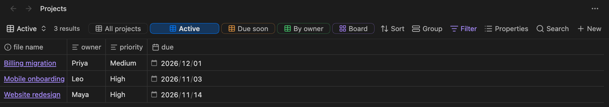
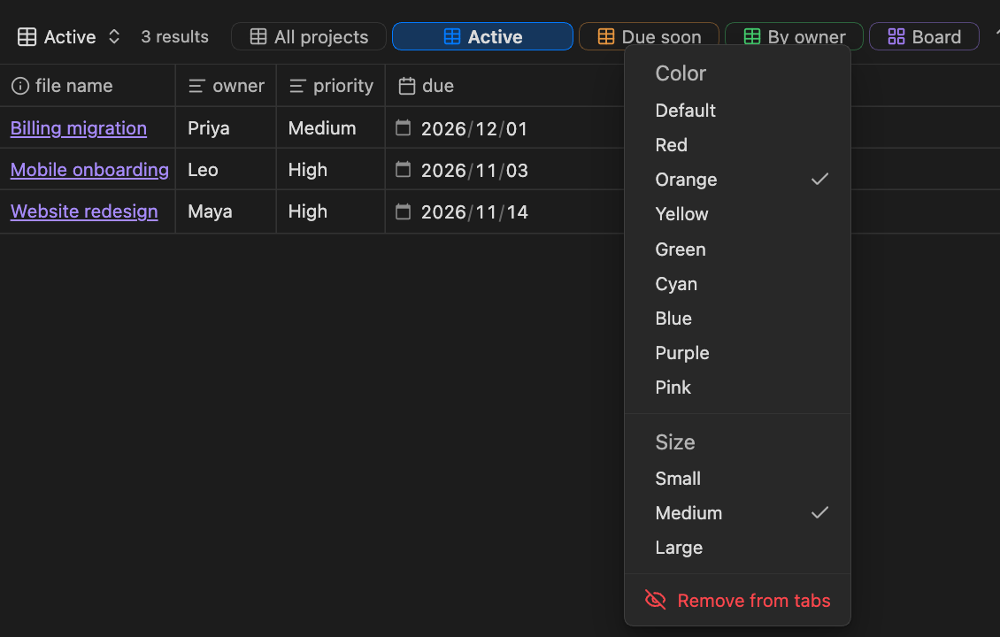
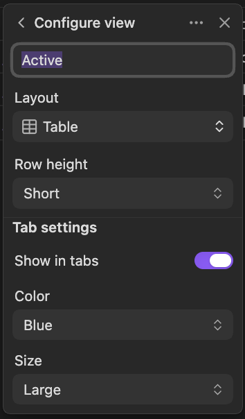

# View Tabs for Bases

[English](../README.md) | **日本語** | [简体中文](README.zh.md) | [繁體中文](README.zh-TW.md) | [한국어](README.ko.md) | [Deutsch](README.de.md) | [Français](README.fr.md) | [Español](README.es.md)

Obsidian の [Base](https://help.obsidian.md/bases) のビューを、ひと目で見渡せるようにするプラグインです。Base のビューを結果件数のすぐ横にタブで並べるので、ビューのメニューを開かずに、ワンクリックで切り替えられます。



## 機能

- **ツールバーにタブ**: ビューごとに、結果件数の横にタブが付きます。タブには、ビューの種類のアイコンが付きます。今のビューのタブは強調されます。
- **ワンクリックで切り替え**: タブを押すと、そのビューに切り替わります。
- **ドラッグで並べ替え**: タブを別のタブの上に落とすと移動します。ビュー自体の順番が変わるので、標準のビューのメニューも同じ並びになります。
- **ビューごとのタブ設定**: ビューごとに、タブに出すかどうか、タブの色(アイコンと枠の色。選んだタブはその色で塗られます)と大きさ(横幅)を決められます。
- **右クリックメニュー**: タブを右クリックすると、色や大きさを変えたり、タブから外したりできます。
- **入りきらないときはスクロール**: タブが入りきらないときは横にスクロールでき(マウスホイールでも動きます)、端がうっすらフェードします。標準のツールバーのボタンは縮みません。
- **ツールバーの下にも置ける**: タブを、ツールバーの下の専用の行に置くこともできます。そこでは、入りきらないタブを次の行へ折り返せます。
- **キーボードで切り替え**: 次のタブ・前のタブに切り替えるコマンドがあり、好きなホットキーを割り当てられます。

## インストール

- **コミュニティプラグイン**: **Settings → Community plugins → Browse** を開き、「View Tabs for Bases」を検索して **Install**、続けて **Enable** を押します。
- **手動**: [最新のリリース](https://github.com/TTTatsuO/obsidian-view-tabs-for-bases/releases/latest)から `main.js`・`manifest.json`・`styles.css` をダウンロードして `<Vault>/.obsidian/plugins/view-tabs-for-bases/` に置き、**Settings → Community plugins** でプラグインを有効にします。

Obsidian 1.14.0 以降が必要です。デスクトップ版のみ対応しています。

## 使い方

`.base` ファイルを開くと、そのビューが結果件数の横にタブで並びます。

タブを変えるときは、タブを右クリックして、色・大きさ・**タブから外す** を選びます。



ビューのメニューから **Configure view**(ビューの設定画面)を開き、一番下の **タブ設定** の節(**タブに表示**・**色**・**大きさ**)で変えることもできます。



タブから外したビューを戻すときは、ビューのメニューからそのビューの **Configure view** を開き、**タブに表示** をオンに戻します。

キーボードでビューを切り替えるには、**Settings → Hotkeys** で **次のビューに切り替え** と **前のビューに切り替え** にホットキーを割り当てます。タブの並び順に移動し、端まで行くと反対側に戻ります。タブから外したビューは飛ばします。初期状態ではホットキーは割り当てられていません。

### プラグインの設定

- **ビューのタブを表示**: オフにすると、すべての Base でタブが消えます。
- **ビューの種類のアイコンを表示**: 各タブに、表やカードなど、ビューの種類のアイコンを出します。既定はオンです。
- **タブの位置**: **結果件数の横**(既定)か **ツールバーの下** を選びます。
- **タブを折り返す**: ツールバーの下で入りきらないタブを、横スクロールの代わりに次の行へ折り返します。**タブの位置** が **ツールバーの下** のときだけ使えます。
- **ビューを切り替えても選択中のセルを保つ**: 下の説明を見てください。

### 選択中のセルを保つ

Obsidian は、ビューを切り替えても、ビューごとに選択中のセルとスクロール位置を覚えています。ただ、同じ種類のビュー同士(たとえば表と表)を行き来すると、ときどき忘れてしまいます。Obsidian は新しいビューでも表を使い回し、新しい行が読み込まれる前に位置を戻そうとするため、前のビューの行数を超えるセルが消えてしまうのです。

**ビューを切り替えても選択中のセルを保つ**(初期設定でオン)は、これを補います。新しい行が読み込まれたあとで、選択中のセルとスクロール位置をもう一度戻します。Obsidian の内部の仕組みを使っているので、ビューの切り替えがおかしいと感じたら、プラグインの設定でオフにしてください。オフにすると、プラグインがないときと同じ動きに戻ります。

### 設定の保存場所

タブの設定は、`.base` ファイルの各ビューの中に、1つのキーにまとめて保存されます。書かれるのは、既定と違う値だけです。

```yaml
views:
  - type: table
    name: Overview
    viewTabsForBases:
      color: blue
      size: large
  - type: table
    name: Drafts
    viewTabsForBases:
      show: false
```

そのため、Base の名前を変えたり、複製したり、同期したりしても、設定は一緒についていきます。プラグインをアンインストールしても、Obsidian はこのキーを無視します。不要なら手で消せます。

## 対応言語

プラグインの表示は、Obsidian の言語設定に従います。対応している言語は、English、العربية、বাংলা、Català、Čeština、Dansk、Deutsch、Ελληνικά、Español、فارسی、Suomi、Français、עברית、Magyar、Bahasa Indonesia、Italiano、日本語、ខ្មែរ、한국어、Nederlands、Norsk、Polski、Português、Português do Brasil、Română、Русский、Slovenčina、Svenska、ไทย、Türkçe、Українська、Tiếng Việt、简体中文、繁體中文 です。それ以外の言語では英語で表示されます。

英語と日本語以外の訳は、まだネイティブの確認を受けていません。おかしな表現があれば、issue を立てるか、[`src/i18n.ts`](../src/i18n.ts) を直すプルリクエストを送ってください。

## 制限

- タブが出るのは、`.base` ファイルをタブで開いたときだけです。ノートに埋め込んだ Base(`![[file.base]]` や `base` コードブロック)には、まだ対応していません。
- ポップアウトしたウィンドウでもタブは動きますが、**Configure view** に **タブ設定** の節は出ません。その場合は、タブの右クリックメニューを使ってください。
- デスクトップ版のみ対応しています。
- Obsidian には、Bases のツールバーやビューの一覧を扱う公開 API がないため、このプラグインは Obsidian の内部の仕組みを使っています。将来の Obsidian のアップデートで、タブが出なくなる可能性があります。その場合、プラグインは何もしなくなるだけです。Base やビューには手を加えず、タブの設定もファイルに残ります。

## ライセンス

[MIT](../LICENSE)
