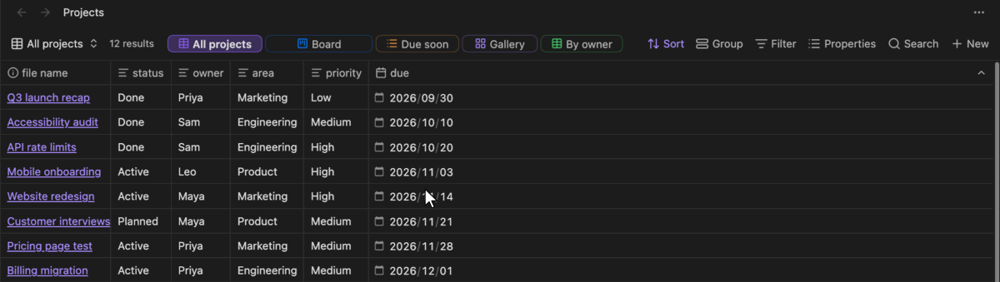
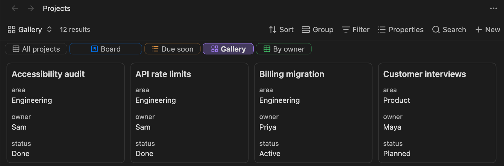

# View Tabs for Bases

[English](../README.md) | [日本語](README.ja.md) | [简体中文](README.zh.md) | **繁體中文** | [한국어](README.ko.md) | [Deutsch](README.de.md) | [Français](README.fr.md) | [Español](README.es.md)

一眼看清 Obsidian [資料庫（Bases）](https://help.obsidian.md/bases)的所有檢視。本外掛把資料庫的檢視以分頁的形式排列在結果數量旁邊，不必打開檢視選單，點一下就能切換檢視。



## 功能

- **工具列中的分頁**：每個檢視在結果數量旁邊都有一個分頁，並帶有檢視類型的圖示；目前檢視的分頁會醒目顯示。
- **一鍵切換**：點擊分頁即可開啟對應的檢視。
- **拖曳排序**：把一個分頁拖到另一個分頁上即可移動。這會改變檢視本身的順序，因此內建的檢視選單也會顯示相同的順序。
- **依檢視設定分頁**：可以為每個檢視選擇是否顯示分頁，並設定分頁的顏色（圖示和外框；選取的分頁會以該顏色填滿）和大小（寬度）。
- **右鍵選單**：在分頁上按右鍵，可以變更顏色或大小，或將其從分頁中移除。
- **放不下時可捲動**：分頁放不下時可以橫向捲動（也支援滑鼠滾輪），兩端會淡出顯示。內建的工具列按鈕不會被壓縮。
- **也可放在工具列下方**：分頁可以放在工具列下方單獨的一列，在那裡放不下的分頁可以換行顯示。
- **鍵盤切換**：提供切換到下一個或上一個分頁的命令，可綁定任意快速鍵。

## 安裝

- **社群外掛**：開啟 **Settings → Community plugins → Browse**，搜尋「View Tabs for Bases」，點擊 **Install**，再點擊 **Enable**。
- **手動安裝**：從[最新版本](https://github.com/TTTatsuO/obsidian-view-tabs-for-bases/releases/latest)下載 `main.js`、`manifest.json` 和 `styles.css`，放入 `<Vault>/.obsidian/plugins/view-tabs-for-bases/`，然後在 **Settings → Community plugins** 中啟用外掛。

需要 Obsidian 1.14.0 或更新版本。僅支援桌面版。

## 使用方式

開啟 `.base` 檔案後，它的檢視會以分頁形式顯示在結果數量旁邊。


要變更分頁，請在分頁上按右鍵，選擇顏色、大小或 **從分頁中移除**。


也可以從檢視選單開啟 **Configure view**（檢視設定），在最下方的 **分頁設定** 區塊（**在分頁中顯示**、**顏色**、**大小**）進行變更。


要恢復已移除的分頁，請從檢視選單開啟該檢視的 **Configure view**，重新開啟 **在分頁中顯示**。

要用鍵盤切換檢視，請在 **Settings → Hotkeys** 中為 **切換到下一個檢視** 和 **切換到上一個檢視** 設定快速鍵。它們依分頁順序移動，到達末端時回到另一端，並略過已從分頁中移除的檢視。預設沒有設定快速鍵。

### 外掛設定

- **檢視分頁位置**：**結果數量旁**（預設）、**工具列下方** 或 **不顯示**。選擇 **不顯示** 後，所有資料庫中的分頁都會隱藏。
- **檢視分頁換行**：在工具列下方放不下的分頁會換到下一行，而不是橫向捲動。僅在 **檢視分頁位置** 為 **工具列下方** 時可用。
- **顯示檢視類型圖示**：在每個分頁上顯示檢視類型的圖示（表格、卡片等）。預設開啟。
- **切換檢視時保留選取的儲存格**：見下文。



### 保留選取的儲存格

切換檢視時，Obsidian 會記住每個檢視選取的儲存格和捲動位置。但在兩個同類型的檢視（例如兩個表格）之間切換再返回時，它有時會遺失這些資訊。Obsidian 會為新檢視重複使用表格，並在新列載入完成之前恢復位置，因此超出上一個檢視列數的儲存格會被捨棄。

**切換檢視時保留選取的儲存格**（預設開啟）可以繞過這個問題：在新列載入完成後，再次恢復選取的儲存格和捲動位置。它依賴 Obsidian 的內部機制，如果切換檢視表現異常，請在外掛設定中將其關閉。關閉後，Obsidian 的行為與未安裝外掛時相同。

### 設定的儲存位置

分頁設定儲存在 `.base` 檔案中各個檢視的內部，統一放在一個鍵之下。只會寫入與預設值不同的值：

```yaml
views:
  - type: table
    name: Overview
    viewTabsForBases:
      color: blue
      size: large
  - type: table
    name: Drafts
    viewTabsForBases:
      show: false
```

因此，重新命名、複製或同步資料庫時，設定會一併保留。解除安裝外掛後，Obsidian 會忽略這個鍵，你也可以手動刪除。

## 語言

外掛會跟隨 Obsidian 的語言設定。支援的語言有：English、العربية、বাংলা、Català、Čeština、Dansk、Deutsch、Ελληνικά、Español、فارسی、Suomi、Français、עברית、Magyar、Bahasa Indonesia、Italiano、日本語、ខ្មែរ、한국어、Nederlands、Norsk、Polski、Português、Português do Brasil、Română、Русский、Slovenčina、Svenska、ไทย、Türkçe、Українська、Tiếng Việt、简体中文 和 繁體中文。其他語言會以英文顯示。

除英文和日文外，其他翻譯尚未經過母語人士審閱。如果你的語言中有不自然的表達，歡迎提出 issue，或送出修改 [`src/i18n.ts`](../src/i18n.ts) 的 pull request。

## 限制

- 只有在獨立分頁中開啟 `.base` 檔案時才會顯示分頁。嵌入在筆記中的資料庫（`![[file.base]]` 或 `base` 程式碼區塊）尚未支援。
- 在彈出視窗中分頁可以正常使用，但 **Configure view** 中不會出現 **分頁設定** 區塊。此時請使用分頁的右鍵選單。
- 僅支援桌面版。
- Obsidian 沒有提供資料庫工具列或檢視清單的公開 API，因此本外掛使用了 Obsidian 的內部機制。未來的 Obsidian 更新可能會使分頁無法顯示。若發生這種情況，外掛只會停止運作：你的資料庫和檢視不會被更動，分頁設定也會保留在檔案中。

## 授權

[MIT](../LICENSE)
